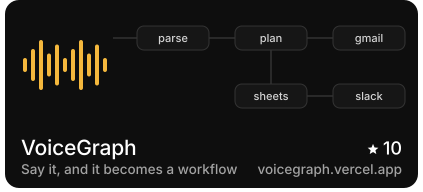

### Currently working on

- [hp](https://github.com/HoneyPaptan/hp-harness): a coding agent harness that resumes from its journal after any crash
- [coffee anatomy](https://github.com/HoneyPaptan/coffee-anatomy): an interactive teardown of an espresso machine
- [VoiceGraph](https://github.com/HoneyPaptan/voicegraph): more spoken triggers and integrations for voice-built workflows
